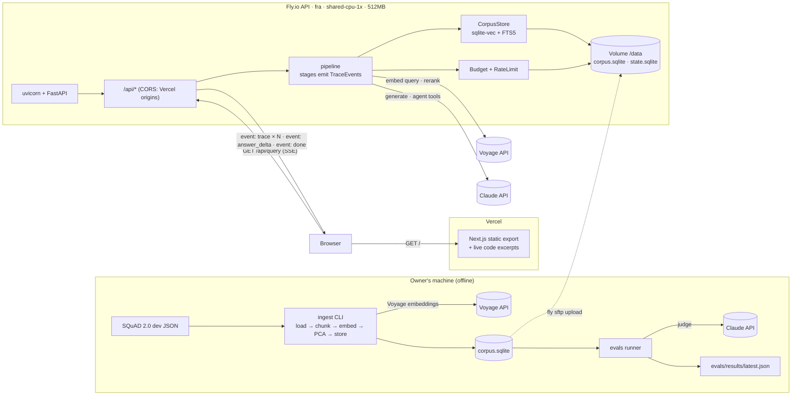

# Highnet Safe LLM Tools — Architecture

Decisions come from [`PROJECT_BRIEF.md`](PROJECT_BRIEF.md). This document describes _how_ they are built, for both products: sections 1–12 describe the shared platform and the RAG pipeline, section 13 describes Scope. Rule zero, for both: **if a stage runs, it emits a trace event.**

## 1. Overview



**Two origins (owner decision, 2026-09-28).**

- The web app is a static export deployed on Vercel.
- The API runs on Fly.io. It allows the Vercel production domain (`CORS_ORIGINS`) and preview deployments (`CORS_ORIGIN_REGEX`) with GET-only CORS.
- The browser finds the API through `NEXT_PUBLIC_API_BASE`, set in the Vercel project.
- Locally, `highnet-rag serve` can still serve `web/out` itself (same origin, no CORS needed).

## 2. Repository layout

```
/                     AGENTS.md, CLAUDE.md, PRODUCT.md, DESIGN.md, README.md, LICENCE.md
                      pyproject.toml (uv workspace: core, api, scope, evals), Dockerfile, fly.toml,
                      .env.example, conftest.py (strips provider keys from every test)
/core                 shared package `highnet_core`, used by both products
  src/highnet_core/
    config.py         CoreSettings: providers, models, budget, rate limits, state DB
    trace.py          TraceEvent (stage: str), Tracer (timing, sequencing, cost roll-up)
    sse.py            server-sent events: one `event: trace` per stage, keep-alives
    pricing.py        price table per model (env-overridable), cost_usd()
    budget.py         monthly caps and per-IP rate limiting, over one shared ledger
    pca.py            two-component PCA fitted at ingest (the RAG map and the Scope map)
    providers/        base.py (Protocols), voyage.py, claude.py (lazy clients), fake.py
    storage/          base.py (StateStore, Projection), state.py (SqliteStateStore)
/api                  the RAG API + ingestion (Python package `highnet_rag`); mounts Scope's routes
  src/highnet_rag/
    app.py            FastAPI factory, routes, static mount, Scope router
    config.py         Settings(CoreSettings): RAG fields
    trace.py          the RAG stage list (narrows TraceEvent.stage for the JSON Schema)
    providers/        wiring, the RAG fake LLM, call caches
    storage/          base.py (CorpusStore, RecordingStore), sqlite.py (sqlite-vec + FTS5)
    pipeline/         classic.py, search.py, retrieve.py, agent.py, prompt.py
    ingest/           squad.py (load), chunk.py, build.py
  tests/              pytest; fake providers, tiny fixture corpus
/scope                Scope (Python package `highnet_scope`), section 13
  src/highnet_scope/  presets/*.json, presets.py, text.py, rules.py, knn.py, judge.py, fusion.py,
                      store.py, models.py, pipeline.py, ingest.py, recorder.py, api.py, cli.py
  tests/              pytest; fake embedder and fake judge over the real labeled prompts
/web                  Next.js App Router, static export
  app/                page.tsx (landing), rag/** (RAG pages), scope/** (Scope pages), layout.tsx,
                      globals.css, og.png routes (one share card per product)
  components/ui/      restyled shadcn primitives (PascalCase) + Button, Typography
  components/pipeline/ StepSheet, WhyThisStep, SettingsStrip, RankTable, CorpusMap, …
  lib/                trace.ts (generated types), useTraceStream.ts, utils.ts (cn)
/evals                golden sets, both eval runners (`highnet_rag_evals`, `highnet_scope_evals`);
                      publishes results/latest.json and results/scope/latest.json
/recordings           questions.json (RAG); scope/examples.json and scope/scope.sqlite (Scope)
/docs                 PROJECT_BRIEF.md, ARCHITECTURE.md, MILESTONES.md
/data                 (gitignored) raw SQuAD JSON, built corpus.sqlite
```

## 3. Backend components

| Component             | Responsibility                                                                                                                                                                                                                                                                         |
| --------------------- | -------------------------------------------------------------------------------------------------------------------------------------------------------------------------------------------------------------------------------------------------------------------------------------- |
| `config.Settings`     | Reads and validates every env var at startup (see `.env.example`). Missing API keys do **not** crash startup; they fail the first request that needs them, as a clean `error` trace event.                                                                                             |
| `providers.voyage`    | `embed(texts, input_type)` and `rerank(query, docs, top_k)` over Voyage's REST API with plain `httpx` (the `voyageai` SDK pulls in LangChain and tokenizers). Each returns results plus token usage. The HTTP client is built lazily on first use (AGENTS.md rule).                    |
| `providers.fake`      | Deterministic offline stand-ins (`FAKE_PROVIDERS=true`, `ingest --fake`): hashed bag-of-words embeddings and an extractive "LLM". No keys and no cost; every event names `provider: "fake"` and the UI labels runs as illustrative.                                                    |
| `providers.claude`    | `count_tokens`, `stream_answer` (streaming, with citations), `agent_turn` (tool use). The client is built lazily. Model IDs come from settings.                                                                                                                                        |
| `storage.CorpusStore` | A read-only Protocol: `chunk_sets()`, `bm25(query, set, k)`, `knn(vector, set, k)`, `chunks(ids)`, `map_points(set)`, `pca(set)`, `meta()`. `SqliteCorpusStore` implements it today; a `PgvectorCorpusStore` can implement it later without touching the pipeline.                     |
| `storage.StateStore`  | A writable Protocol: `record_spend(...)`, `month_spend()`, `record_run(...)`, `hits(ip_hash, window)`. It lives in a separate `state.sqlite`, so the corpus file can be swapped atomically.                                                                                            |
| `budget`              | Pre-flight checks (rate limit, monthly budget, degradation tier) and post-call spend recording. Its decisions are emitted as the `request` stage.                                                                                                                                      |
| `pipeline.classic`    | Runs the fixed stage sequence (§4) for one query.                                                                                                                                                                                                                                      |
| `pipeline.agentic`    | A manual Claude tool-use loop with the tools `search(query, mode, k)` and `answer()`, capped at `AGENT_MAX_STEPS`. Each tool call runs the retrieval stages again and emits them with a `parent` step. It is a manual loop, not the SDK tool runner, so every turn is a visible stage. |
| `trace.Tracer`        | A context manager per stage. It measures `ms`, assigns `seq`, attaches `tokens` and `cost_usd`, catches exceptions and turns them into an `error` event, and yields events onto the SSE queue.                                                                                         |

No LangChain or similar framework. Each stage is a plain function: `(inputs) -> (outputs, TraceEvent)`.

## 4. Pipeline stages & the trace-event schema

### Stage sequence (classic mode)

| seq | `stage`                    | Emitted when                                                                                                                               | `data` (main fields)                                                                                                                                                                                                                                          |
| --- | -------------------------- | ------------------------------------------------------------------------------------------------------------------------------------------ | ------------------------------------------------------------------------------------------------------------------------------------------------------------------------------------------------------------------------------------------------------------- |
| 1   | `request`                  | always                                                                                                                                     | `run_id`, echoed `settings`, `model`, `rate_limit` {remaining_min, remaining_day}, `budget` {spent_usd, cap_usd, degrade_at_usd, tier: `normal`\|`degraded`\|`stopped`}                                                                                       |
| 2   | `embed_query`              | mode ∈ {vector, hybrid}; skipped in BM25 mode (no embedding call)                                                                          | `model`, `dims`, `input_type: "query"`, `vector_preview` (first 8 dims), `norm`, `retries`                                                                                                                                                                    |
| 3   | `map_project`              | when there is a query embedding; otherwise skipped                                                                                         | `x`, `y` of the query in the chunk set's PCA space, `explained_variance`, `neighbours_2d` (the 5 nearest chunk ids in 2D)                                                                                                                                     |
| 4   | `bm25`                     | mode ∈ {bm25, hybrid}; otherwise `status: "skipped"`                                                                                       | `fts_query` (the FTS5 MATCH string actually run: distinct non-stopword terms, each quoted), `words` [{word, term\|null}], `terms` [{term, chunks, idf}] (IDF as FTS5 computes it), `depth`, `results` [{chunk_id, rank, score (higher is better), doc_title}] |
| 5   | `vector`                   | mode ∈ {vector, hybrid}; otherwise skipped                                                                                                 | `metric: "cosine"`, `depth`, `results` [{chunk_id, rank, distance, doc_title}]                                                                                                                                                                                |
| 6   | `fuse`                     | mode = hybrid; otherwise skipped. Each search then fetches 2 × top-k                                                                       | `method: "rrf"`, `k: 60`, `kept` (top-k), `results` [{chunk_id, rank, score, doc_title, from: {bm25_rank, vector_rank}, contributions: {bm25, vector}}]                                                                                                       |
| 7   | `rerank`                   | reranker on and budget below 80%; otherwise skipped with the reason. A failure is a `warning` with `error` and `fallback` (the order kept) | `model`, `input` (the ranking reranked), `kept`, `retries`, `results` [{chunk_id, rank, before_rank, relevance, doc_title}] over all 2 × top-k candidates                                                                                                     |
| 8   | `select_context`           | always                                                                                                                                     | `top_k`, `ranking` (`bm25`\|`vector`\|`fuse`), `score_name`, `chunks` [{chunk_id, rank, doc_title, score, text, approx_tokens}], `context_tokens_approx`                                                                                                      |
| 9   | `prompt`                   | always                                                                                                                                     | `system`, `messages` (the exact request body minus the API key), `input_tokens` (from `count_tokens`), `max_tokens`, `worst_case_cost_usd`, `context_window` (documented models only, else null), `parts_approx` {system, passages, question}                 |
| 10  | `generate`                 | always                                                                                                                                     | `model`, `stop_reason`, `usage` {input_tokens, output_tokens, cache_read_input_tokens}, `answer`, `cost_split` {input_usd, output_usd}                                                                                                                        |
| 11  | `citations`                | always                                                                                                                                     | `citations` [{block, chunk_id, doc_title, rank, cited_text}], `blocks` (answer text with citation markers), `unused_chunk_ids`, `abstained`                                                                                                                   |
| 12  | `done` (SSE `event: done`) | always, last                                                                                                                               | totals: `ms`, `tokens`, `cost_usd`, `stages`                                                                                                                                                                                                                  |

**Agentic mode** (`agentic=true`) replaces stages 2–7 with a Claude tool-use loop (`pipeline/agent.py`; tools `search` and `answer`):

- `agent_plan` (label `2`): the model's first turn: plan text, planned queries, the caps and the agent's instructions;
- then, per tool call, `agent_step` (labels `3a`, `3b`, …: tool, input, the turn's note; `answer`, `stop` with the cap that ended the loop, tool errors as warnings, and tool-less turns); each `search` is followed by that search's retrieval stages from `pipeline/search.py` (`embed_query`, `bm25`, `vector`, `fuse`, `rerank`, no map), each carrying `parent: "<step label>"` and a sub-label (`3a.1`, `3a.2`, …);
- then `select_context` (`4`, the passages found, best search rank first), `prompt` (`5`), `generate` (`6`) and `citations` (`7`) as usual.

Past the 80% budget mark `agent_plan` is skipped with the reason and the classic stages run instead.

`AGENT_MAX_STEPS` (default 4), `AGENT_TOKEN_CAP` (30,000 tokens across the agent's turns), `AGENT_TURN_MAX_TOKENS` (512), a limit of `AGENT_MAX_STEPS + 2` turns and the worst-case budget guard are enforced before every turn and shown in the trace.

### TraceEvent (SSE `event: trace`)

The base shape is the one fixed in the brief, plus bookkeeping fields:

```json
{
  "run_id": "01J…",
  "seq": 5,
  "stage": "vector",
  "status": "ok",
  "parent": null,
  "label": "5",
  "data": { "metric": "cosine", "results": [{ "chunk_id": 812, "rank": 1, "distance": 0.214 }] },
  "ms": 42,
  "tokens": 0,
  "cost_usd": 0
}
```

| Field      | Type                                      | Meaning                                                                                                                                      |
| ---------- | ----------------------------------------- | -------------------------------------------------------------------------------------------------------------------------------------------- |
| `run_id`   | string (ULID)                             | One per query                                                                                                                                |
| `seq`      | int                                       | Order of emission; the client sorts by it                                                                                                    |
| `stage`    | enum                                      | See the table above                                                                                                                          |
| `status`   | `ok` \| `skipped` \| `error` \| `warning` | `skipped` always carries `data.reason`; `error` carries `data.error` {type, message}; `warning` is ok with a caveat, such as a low top score |
| `parent`   | string \| null                            | Parent `agent_step` id in agentic mode                                                                                                       |
| `label`    | string                                    | The human step number shown on the pad ("5", "4b")                                                                                           |
| `data`     | object                                    | Stage-specific payload; each stage has its own Pydantic model                                                                                |
| `ms`       | int                                       | Wall time of this stage                                                                                                                      |
| `tokens`   | int                                       | Tokens billed by this stage (embedding, rerank, or LLM input + output)                                                                       |
| `cost_usd` | float                                     | Cost of this stage from `pricing.py`, rounded to 6 decimal places                                                                            |

The other SSE events are:

- `event: answer_delta`: `{run_id, text}` while `generate` streams. This is a UI convenience; the full answer is still in the `generate` trace event.
- `event: done`: the totals.
- A `: keep-alive` comment every 15 s.

The Pydantic models are the source of truth. `uv run highnet-rag schema` exports JSON Schema to `web/lib/generated/trace.schema.json`, and `json-schema-to-typescript` turns that into `web/lib/generated/trace.ts`. CI fails if the generated files are stale.

## 5. HTTP endpoints

| Method & path                    | Returns             | Notes                                                                                                                                                                                                                                                                                                     |
| -------------------------------- | ------------------- | --------------------------------------------------------------------------------------------------------------------------------------------------------------------------------------------------------------------------------------------------------------------------------------------------------- |
| `GET /api/query`                 | `text/event-stream` | Query params: `q` (≤ 500 chars), `mode` (`bm25`\|`vector`\|`hybrid`, default `hybrid`), `k` (1–10), `chunk_set` (name: `small`\|`medium`\|`large`), `rerank` (bool, default false), `agentic` (bool, default false). GET makes it work with `EventSource`. The response is not cached and not compressed. |
| `GET /api/config`                | JSON                | Allowed settings, chunk sets, defaults, suggested questions, the models in use, and the current budget tier.                                                                                                                                                                                              |
| `GET /api/corpus/map?chunk_set=` | JSON                | `points` [[chunk_id, doc_id, x, y]], `documents` {id: title}, `explained_variance` for the 2D map. Immutable per corpus build (ETag = build id).                                                                                                                                                          |
| `GET /api/chunks/{id}`           | JSON                | Chunk text, document title, character offsets, and neighbouring chunk ids                                                                                                                                                                                                                                 |
| `GET /api/corpus/documents`      | JSON                | Every article (title, source, length) with its chunk count per chunk set, for the corpus page                                                                                                                                                                                                             |
| `GET /api/corpus/documents/{id}` | JSON                | One article's text and its chunks' character offsets for a chunk set (`?chunk_set=`)                                                                                                                                                                                                                      |
| `GET /api/evals`                 | JSON                | The latest published eval results, or 404 before the first run                                                                                                                                                                                                                                            |
| `GET /api/health`                | JSON                | Liveness plus the corpus build id, Scope's build id and latest recording (`scope`, `scope_recorded_at`); used by Fly health checks and the deploy job                                                                                                                                                  |
| `GET /api/scope/config`          | JSON                | Scope's presets (full definitions), example messages, default weights and thresholds, models, when it was recorded, the build, the budget tier (section 13)                                                                                                                                           |
| `GET /api/scope/run`             | `text/event-stream` | One message through Scope's 11 steps: `preset`, `example`, `context`, `rules`, `knn`, `judge`, `w_rules`, `w_knn`, `w_judge`, `t_block`, `t_answer`, `t_brief`, `k`, `edit=topic:class,…` (section 13)                                                                                                 |
| `GET /*`                         | static              | `web/out`, with `index.html` fallbacks for the static routes                                                                                                                                                                                                                                              |

## 6. SQLite schema

**`corpus.sqlite`**: built locally and read-only in production.

```sql
CREATE TABLE meta (key TEXT PRIMARY KEY, value TEXT NOT NULL);
-- build_id, built_at, embed_model, embed_dims, corpus ('squad-2.0-dev'), licence ('CC BY-SA 4.0'), source_url

CREATE TABLE documents (
  id INTEGER PRIMARY KEY,
  title TEXT NOT NULL,
  text TEXT NOT NULL,              -- full article text (paragraphs joined by \n\n)
  source_url TEXT NOT NULL
);

CREATE TABLE chunk_sets (
  id INTEGER PRIMARY KEY,
  name TEXT NOT NULL UNIQUE,       -- 'small' | 'medium' | 'large'
  target_tokens INTEGER NOT NULL,  -- ~100 | ~250 | ~500
  overlap_tokens INTEGER NOT NULL
);

CREATE TABLE chunks (
  id INTEGER PRIMARY KEY,
  chunk_set_id INTEGER NOT NULL REFERENCES chunk_sets(id),
  doc_id INTEGER NOT NULL REFERENCES documents(id),
  ord INTEGER NOT NULL,            -- position within the document
  text TEXT NOT NULL,
  start_char INTEGER NOT NULL,     -- offsets into documents.text
  end_char INTEGER NOT NULL,
  approx_tokens INTEGER NOT NULL,  -- estimate (words × 4/3); exact counts come from the APIs
  x REAL NOT NULL, y REAL NOT NULL -- PCA 2D coordinates within its chunk set
);
CREATE INDEX chunks_set_doc ON chunks(chunk_set_id, doc_id, ord);

CREATE VIRTUAL TABLE chunks_fts USING fts5(
  text, chunk_set_id UNINDEXED,
  content='chunks', content_rowid='id', tokenize='porter unicode61'
);

CREATE VIRTUAL TABLE chunk_vec USING vec0(
  chunk_id INTEGER PRIMARY KEY,
  chunk_set_id INTEGER PARTITION KEY,
  embedding FLOAT[1024] distance_metric=cosine
);

CREATE TABLE pca (
  chunk_set_id INTEGER PRIMARY KEY REFERENCES chunk_sets(id),
  mean BLOB NOT NULL,              -- float32[1024]
  components BLOB NOT NULL,        -- float32[2][1024]
  explained_variance TEXT NOT NULL -- JSON [pc1, pc2]
);
```

**`state.sqlite`**: created at startup on the volume; writable.

```sql
CREATE TABLE runs (
  run_id TEXT PRIMARY KEY, ts TEXT NOT NULL, ip_hash TEXT NOT NULL,
  settings TEXT NOT NULL, status TEXT NOT NULL, ms INTEGER, cost_usd REAL
);
CREATE TABLE spend (
  id INTEGER PRIMARY KEY, ts TEXT NOT NULL, run_id TEXT, provider TEXT NOT NULL,
  model TEXT NOT NULL, stage TEXT NOT NULL, input_tokens INTEGER, output_tokens INTEGER,
  cost_usd REAL NOT NULL
);
CREATE INDEX spend_month ON spend(ts);
```

IPs are stored only as a salted hash (`IP_HASH_SALT`). Rows in `runs` older than 30 days are pruned at startup.

## 7. Ingestion (local)

`uv run highnet-rag ingest --source data/squad/dev-v2.0.json --out data/corpus.sqlite`

1. **Load.** Parse SQuAD 2.0 dev: 35 articles, their paragraphs, and questions (kept for the evals).
2. **Chunk.** Three chunk sets: `small` (~100 tokens), `medium` (~250), `large` (~500), each with ~15% overlap. Chunks are sentence-aligned and never cross article boundaries. Character offsets are kept so answer spans map to chunks exactly.
3. **Embed.** `voyage-3.5-lite`, `input_type="document"`, 1024 dims, batched. Token usage and cost are printed.
4. **Store + index.** Write the tables above and rebuild FTS5.
5. **PCA.** For each chunk set, centre the vectors, take the top-2 components via numpy SVD, and store the mean, the components and the explained variance. The same transform projects each query at request time (`map_project`).
6. **Report.** A per-set summary of chunk counts, token totals, cost and the new build id.

Upload: `scripts/upload-corpus.sh` copies the file to `/data/corpus.sqlite.new` with `fly ssh sftp`, then atomically renames it and restarts the machine.

## 8. Budget, rate limiting & degradation

- **Pricing.** `pricing.py` maps model → $/1M input and output tokens, and can be overridden with `PRICE_OVERRIDES` (JSON). Defaults at the time of writing:

  | Model              | $/1M input | $/1M output |
  | ------------------ | ---------- | ----------- |
  | `claude-haiku-4-5` | $1         | $5          |
  | `claude-sonnet-5`  | $2         | $10         |
  | `claude-opus-5`    | $5         | $25         |

  Voyage `voyage-3.5-lite` and `rerank-2.5-lite` are priced per token (verify when building).

- **Rate limits.** Per salted IP hash (from the `Fly-Client-IP` header), counted across both products: `RATE_LIMIT_PER_MIN=20`, `RATE_LIMIT_PER_DAY=200`. Enforced from `state.sqlite`, so the limits survive machine stops.
- **Monthly cap.** `BUDGET_MONTHLY_USD=20`, one cap for both products, measured over the UTC calendar month from the `spend` table (Scope's live calls, when `SCOPE_LIVE=true`, are recorded there too):
  - ≥ `BUDGET_DEGRADE_AT=0.8`: `degraded` tier. Agentic mode and the demo model are disabled; the UI shows a banner.
  - ≥ 1.0: `stopped` tier. `/api/query` emits only `request` (status `error`, reason `budget_exhausted`) and `done`.
- **Worst-case guard.** Before any Claude call, the pipeline checks that the estimated cost of this call (from `count_tokens` plus `max_tokens`) fits in the remaining budget. If it doesn't, the pipeline refuses the call and says so in the trace.
- The Anthropic and Voyage console spend limits are set to match (see the README deploy steps).

## 9. Frontend

- **Static export** (`output: 'export'`, `images.unoptimized`, `trailingSlash: true`). No server components depend on runtime data. Everything live comes from `/api`.
- **`useTraceStream(params)`** opens an `EventSource`, collects `trace` events by `seq`, appends `answer_delta` text, and closes on `done`/`error`. It exposes `{steps, answer, totals, status}`. A `Cancel` action closes the stream.
- **Pipeline view:** the settings strip (a drawer on phones) sits above the list of `StepSheet`s. Each `StepSheet` renders:
  - its stage's card: `RankTable`, `CorpusMap`, `PromptView`, `AnswerWithCitations`, …;
  - `WhyThisStep`, a plain-language note in blue pencil, with an expandable technical layer;
  - the `ms`, `tokens` and `cost_usd` readout.

  Explanations live in `web/content/stages.ts`, the English message catalogue.

- **Accessibility:**
  - One polite `aria-live` region announces "Step 5 of 11, vector search, done in 42 ms". It announces stage completions only, not every delta.
  - The map has a table alternative, and every control is keyboard-reachable.
- **Tests:** Vitest with Testing Library, as a smoke test. A recorded SSE fixture is fed through `useTraceStream`, and the test asserts that every stage renders a card with its "Why this step?".

### Live code excerpts (single source of truth)

- **Markers in the source.** Each step's code is marked in `api/src` with `# snippet: <stage[,stage]> | <title>` and `# /snippet` comments. The stage section in `pipeline/classic.py` comes first, then the storage or provider functions it calls.
- **Generator.** `web/scripts/gen-snippets.mjs` runs as `prebuild` and as `npm run gen:snippets`. It extracts and dedents each region, records `file:startLine–endLine`, pre-highlights it with highlight.js (Python grammar only, at build time, so no highlighter ships to the browser), and writes `web/lib/generated/snippets.json`.
- **Drift check.** CI regenerates the file and fails if the committed copy differs.
- **Rendering.** `CodeSnippet` renders each excerpt collapsed under "Show the code", with a link to the lines on GitHub. Token colours come from the pad palette (`.hljs-*` in `globals.css`).

### Phones: one line per step

Below 768px each `StepSheet` folds to a single row: number, title, a one-line summary of the key value (`lib/step-summary.ts`), and status. Tapping it expands the details, the "Why this step?" note and the code. A full run page is about 2,000px tall on a 390px screen instead of about 5,500px.

### Design tokens → Tailwind v4 & shadcn

`DESIGN.md` frontmatter is normative. `web/app/globals.css` maps it onto shadcn's CSS variables and exposes them through `@theme inline` (AGENTS.md: tokens live only in `globals.css`). Dark mode uses the `lamp-*` values under `.dark`, and a class set from `prefers-color-scheme` plus the toggle.

| shadcn variable                                 | Light (DESIGN.md token)                                                 | Dark (`lamp-…`)       | Used for                                  |
| ----------------------------------------------- | ----------------------------------------------------------------------- | --------------------- | ----------------------------------------- |
| `--background`                                  | `paper`                                                                 | `lamp-paper`          | page / pad                                |
| `--foreground`                                  | `graphite`                                                              | `lamp-graphite`       | text                                      |
| `--card`, `--popover`                           | `paper-raised`                                                          | `lamp-paper-raised`   | step sheets, overlays                     |
| `--card-foreground`, `--popover-foreground`     | `graphite`                                                              | `lamp-graphite`       |                                           |
| `--primary`                                     | `blue-pencil`                                                           | `lamp-blue-pencil`    | primary action, active step               |
| `--primary-foreground`                          | `paper`                                                                 | `lamp-paper`          |                                           |
| `--secondary`, `--accent`                       | `blue-wash`                                                             | `lamp-blue-wash`      | selection, hover wash                     |
| `--secondary-foreground`, `--accent-foreground` | `graphite`                                                              | `lamp-graphite`       |                                           |
| `--muted`                                       | `grid`                                                                  | `lamp-grid`           | quiet fills                               |
| `--muted-foreground`                            | `graphite-muted`                                                        | `lamp-graphite-muted` | units, secondary labels                   |
| `--destructive`                                 | `red-check`                                                             | `lamp-red-check`      | failures only                             |
| `--border`                                      | `rule`                                                                  | `lamp-rule`           | decorative rules                          |
| `--input`                                       | `rule-input`                                                            | `lamp-rule-input`     | control borders (≥ 3:1)                   |
| `--ring`                                        | `blue-pencil`                                                           | `lamp-blue-pencil`    | focus                                     |
| `--chart-1…5`                                   | `data-vector`, `data-bm25`, `data-fused`, `data-rerank`, `data-neutral` | `lamp-data-*`         | charts, rank badges                       |
| `--radius`                                      | `rounded.md` (4px)                                                      | same                  | `rounded-sm` = 2px                        |
| extra: `--warning`, `--success`                 | `amber-note`, `green-tick`                                              | `lamp-…`              | exposed as `text-warning`, `text-success` |

The font is Recursive via `next/font/google` (self-hosted at build time, so the export makes no runtime request to Google), with the `CASL`, `MONO` and `slnt` axes. The typography roles become `Typography` CVA variants (`sheetTitle`, `stepHeading`, `body`, `marginNote`, `data`, `label`).

## 10. Deployment

### API on Fly.io

- **`fly.toml`:**
  - app `highnet-safe-llm-tools` (renamed from `highnet-rag`, 2026-10-29), `primary_region = "fra"`;
  - `[http_service]`: `internal_port = 8080`, `force_https = true`, `auto_stop_machines = "stop"`, `auto_start_machines = true`, `min_machines_running = 0`, connection-based concurrency for SSE;
  - an HTTP check on `/api/health`;
  - `[[vm]]`: `size = "shared-cpu-1x"`, `memory = "512mb"`;
  - `[mounts]`: `source = "rag_data"`, `destination = "/data"`;
  - `[env]`: `CORS_ORIGINS` and `CORS_ORIGIN_REGEX` for the Vercel domains.
- **Dockerfile (API only):**
  - `python:3.12-slim` plus the `uv` binary runs `uv sync --frozen --no-dev --package highnet-rag`.
  - An entrypoint hands the root-owned volume to a non-root user, then runs `uvicorn highnet_rag.app:app --port 8080 --workers 1`.
- **SSE unbuffered:**
  - the response has `Content-Type: text/event-stream`, `Cache-Control: no-cache, no-transform`, `X-Accel-Buffering: no`;
  - no GZip middleware;
  - keep-alive comments every 15 s.
- **Secrets** (`fly secrets set`): `ANTHROPIC_API_KEY`, `VOYAGE_API_KEY`, `IP_HASH_SALT`.
- **Cold start:** the machine scales to zero. The first request starts it in about 2–5 s, and the UI shows "starting the lab…" until `/api/config` answers.

### Web on Vercel

- A Vercel project with **Root Directory `web/`**, deploying through the GitHub integration: production on `main`, previews on every other branch and PR.
- `web/vercel.json` pins the install and build commands and adds basic security headers.
- `prebuild` regenerates the code excerpts from `api/src`; Vercel includes files outside the root directory by default. If those files are missing, the committed JSON is kept.
- **Environment:** `NEXT_PUBLIC_API_BASE=https://highnet-safe-llm-tools.fly.dev` for Production and Preview.
- **Redirects (`web/vercel.json`).** A static export cannot use `next.config` redirects, so Vercel serves permanent (308) redirects: `/corpus/`, `/evals/` and `/coverage/` go to their `/rag/` pages, and `/` with a `q` query parameter (an old shared RAG run link such as `/?q=…&mode=hybrid`) goes to `/rag/` with the query string kept, so the link replays the same run.

### CI (`.github/workflows/ci.yml`)

- **`api` job:** Ruff, pyright, pytest with 100% coverage, and the trace-schema drift check.
- **`web` job:** ESLint, `tsc`, Vitest with 100% coverage, the snippet drift check, `next build`, and `impeccable detect`.
- **`deploy-api` job:** on push to `main`, after both jobs pass: provision (idempotent), `flyctl deploy --remote-only`, build the corpus only if the API has none, then `scripts/fly-ensure-scope.sh` uploads the committed `scope.sqlite` if the live build id or latest recording differs.
- Drift checks also cover Scope: its trace and results schemas, `lib/generated/scope-evals-latest.json`, and the exported `public/scope/dataset.json` and `lib/generated/scope-verdicts.json`.

Tests never call real APIs; providers are faked.

## 11. Evals

`/evals` is a uv workspace member that depends on `highnet_rag` and runs the real pipeline offline.

- **Golden sets** (`evals/golden/*.jsonl`):
  - `squad_auto` (~150): answerable and unanswerable questions from the SQuAD dev set. Relevance is computed exactly: a chunk is relevant when it contains the gold answer's character span.
  - `owner` (~20): written by the owner.
  - `compound` (~10): cross-article questions for agentic mode.
- **Metrics:**
  - recall@k (k = 1, 3, 5, 10) and MRR, per mode × chunk set × rerank; each answerable question is ranked once to depth 10 through `pipeline/search.retrieve`;
  - answers through the default configuration, end to end (`run_classic`): the `CLAUDE_MODEL_JUDGE` model marks each answer sentence as supported or not by the passages sent, and the answer as correct or not against the expected answer (a forced `grade` tool call);
  - abstention, on unanswerable questions (the right behaviour) and on answerable ones (a miss), and whether a chunk holding the gold answer was among the passages sent;
  - the compound questions through the classic pipeline and agentic mode: were all the needed articles found, correctness, searches, tokens, cost;
  - cost and latency per configuration, from the run's own ledger (eval runs never touch the visitor budget).
- **Output:** `evals/results/latest.json`, a dated copy and a dated `*.details.jsonl` (every question's answer and grade), committed. The Evals workflow (manual) downloads the live corpus from Fly, runs a smoke test and the full set, and pushes the results to an `evals/run-<id>` branch. The web build reads `latest.json` at build time; the site never shows numbers that aren't in that file.

## 12. Pre-recorded questions (replay)

Owner decision: visitors only pick from recorded questions, so a visit costs nothing.

- **Questions:** `recordings/questions.json` (id, question, compound).
- **Recording:** `highnet-rag record` (the manual **Record demo questions** workflow) runs the real pipeline for every question at every setting a visitor can choose: search mode × top-k 3/5/10 × chunk size × reranker, and agentic mode for compound questions. It writes each run's SSE items with their time offsets to `data/recordings.sqlite` (zlib-compressed, via `RecordingStore`). A cache in front of the model reuses one call when two settings send the same prompt (same passages, or the agent's first turn); each recording still shows that call's own tokens and cost, and the recorder reports only what was actually paid. It resumes: settings already recorded are skipped, and the workflow uploads partial progress.
- **Replay:** with `LIVE_QUERIES=false` (the default), `GET /api/query?question_id=…&mode=&k=&chunk_set=&rerank=&agentic=` looks up that recording and streams it under a fresh run id, at the recorded pace with pauses capped at 1.5 s (`REPLAY_SPEED` scales it). The `request` event is rebuilt live: rate limit and budget are checked now and shown, and `data.recording` says when the run was recorded. An unknown question or an unrecorded setting is a 404.
- **Config:** `/api/config` adds `live`, `questions` and `recorded` (`ks`, `at`); the page shows the picker instead of the text box, limits top-k to the recorded values, enables the agent only for compound questions, and replays at once when a setting changes.

## 13. Scope

Scope shows a product agent guarding its scope. One message (with its earlier turns, if any) runs through eleven steps, one trace event each, and ends in one action: **answer** (in), **answer briefly** (adjacent), **redirect** (off scope) or **block** (injection or abuse).

### Presets and the scope definition

`scope/src/highnet_scope/presets/<id>.json`: the product, a description, the redirect and block messages, and a list of **topics**, each with a class (`in`, `adjacent`, `out`; `injection` is fixed) and a few keywords. Every labeled prompt carries one topic. A visitor's edit moves topics between classes: the prompts with that topic change label (so the kNN vote changes), the keyword rules change, and the judge's rubric changes, so the recorded judge call no longer applies and the step is skipped with the reason "rubric changed; this run was recorded with the original rubric". No edit needs a model call.

### Built once (`highnet-scope ingest`)

1. Load `evals/golden/scope/<preset>.jsonl` (300 per preset; each row validated: its label must be its topic's class) and `recordings/scope/examples.json`.
2. Embed each prompt as it is read (with its earlier turns) with `voyage-3.5-lite`, `input_type="query"`, in batches.
3. Fit a two-component PCA per preset (`highnet_core.pca`) and store prompts, vectors, x/y, the PCA and the examples in `scope.sqlite`.

`highnet-scope record` then runs every example through the pipeline with the real models, with and without its context, and also records both answers (full and brief), so a visitor who changes the action by moving a threshold still sees a real answer. `highnet-scope export` writes the dataset for the web app (`web/public/scope/dataset.json`) and the default-settings verdict of every RAG-assistant example (`web/lib/generated/scope-verdicts.json`), which RAG's first step shows.

### The eleven steps (`pipeline.py`)

| #   | `stage`      | What it does | `data` (main fields) |
| --- | ------------ | ------------ | -------------------- |
| 1   | `request`    | preset and example exist; length ≤ `SCOPE_MAX_MESSAGE_CHARS`; a language guess; the per-IP rate limit (live on every replay); the budget (live mode) | `message`, `chars`, `max_chars`, `language`, `settings`, `models`, `recorded_at`, `rate_limit`, `budget`, `error` |
| 2   | `context`    | joins up to `SCOPE_CONTEXT_TURNS` earlier turns before the message; skipped when there are none or context is off | `turns`, `dropped`, `reading` |
| 3   | `rules`      | injection patterns in four views (raw, normalized, decoded, hidden), channel evidence (zero-width, hidden HTML, encoded, homoglyphs), topic keywords; P(injection) = 1 − ∏(1 − wᵢ); abstains when nothing fires | `hits` [{rule, kind, view, match, weight, label, topic}], `injection_score`, `topic_votes`, `distribution` |
| 4   | `embed`      | the reading embedded (replayed by exact text) | `model`, `input`, `dims`, `vector_preview`, `norm`, `recorded_at`, `replayed` |
| 5   | `map`        | projected with the preset's PCA | `x`, `y`, `explained_variance`, `neighbours_2d` |
| 6   | `knn`        | cosine similarity against the preset's unit vectors; the top k vote, weighted by max(cos, 0); labels follow the definition in force | `k`, `neighbours` [{id, text, topic, label, relabelled, similarity}], `distribution`, `relabelled_topics` |
| 7   | `judge`      | Claude Haiku with the rubric; the message inside `<message>` tags (imitation tags neutralised), the reply prefilled with `{` and validated by `JudgeVerdict` (extra keys forbidden, label one of four, confidence 0–1). Invalid reply: `error`, and the judge drops out | `system`, `messages`, `raw`, `verdict` or `error`, `distribution` |
| 8   | `fuse`       | P(label) = Σ wᵢ·Pᵢ / Σ wᵢ over the signals that ran | `weights`, `used_weights`, `signals`, `contributions`, `distribution`, `label`, `confidence`, `tradeoff` (ms and $ per signal and cumulatively) |
| 9   | `thresholds` | block if P(injection) ≥ `t_block`; else scope = (P(in) + ½P(adj)) / (P(in)+P(adj)+P(out)) against `t_answer` and `t_brief` | `thresholds`, `p_injection`, `scope_score`, `action` |
| 10  | `respond`    | the preset's redirect or block message, or the recorded answer under hard caps (300 / 120 tokens, 1,500 / 500 characters); for the RAG assistant, a hand-off to the RAG pipeline | `action`, `text`, `max_tokens`, `max_chars`, `truncated`, `rag_question` |
| 11  | `audit`      | the record a reviewer would see (shown, not stored): action, signals, rule hits, rubric hash, a SHA-256 of the message, and why it needs review (low confidence, disagreeing signals, any block) | `stored: false`, `record`, `review_reasons` |

### Recorded and live models (`models.py`)

`RecordedModels` (the default, `SCOPE_LIVE=false`) only looks calls up in `scope.sqlite`, keyed by exactly what was sent: an embedding by its text, a completion by kind, model, system prompt, messages and `max_tokens`. A call never recorded is a `NotRecordedError`, shown in the trace, never a guess. `LiveModels` calls Voyage and Claude, prices each call with `pricing.py`, records it, and (outside the recorder and the evals) writes the spend to the shared ledger. Model steps report their recorded time, tokens and cost; replays keep the recorded pace, pauses capped at 1.5 s.

### `scope.sqlite`

```sql
CREATE TABLE meta (key TEXT PRIMARY KEY, value TEXT NOT NULL);   -- build_id, built_at, embed model, tokens, cost
CREATE TABLE prompts (id TEXT PRIMARY KEY, preset TEXT, ord INTEGER, label TEXT, topic TEXT, text TEXT,
  context TEXT /* JSON */, tags TEXT /* JSON */, lang TEXT, x REAL, y REAL, embedding BLOB /* float32[1024] */);
CREATE TABLE pca (preset TEXT PRIMARY KEY, mean BLOB, components BLOB, explained_variance TEXT);
CREATE TABLE examples (id TEXT PRIMARY KEY, preset TEXT, ord INTEGER, text TEXT, context TEXT, note TEXT,
  rag_question TEXT);
CREATE TABLE calls (key TEXT PRIMARY KEY, kind TEXT, provider TEXT, model TEXT, request TEXT, response TEXT,
  embedding BLOB, input_tokens INTEGER, output_tokens INTEGER, ms INTEGER, cost_usd REAL, recorded_at TEXT);
```

The file is committed (`recordings/scope/scope.sqlite`, about 6 MB) because it is the build: the dataset vectors and every paid call. CI uploads it to the volume as `/data/scope.sqlite`.

### Evals (`highnet-scope-evals run`)

Every labeled prompt through four methods: rules alone (silence means the middle band), kNN leave-one-out, the judge (real calls, cached in `data/scope-evals.sqlite` so a rerun is free) and the fused pipeline with the default weights and thresholds. The action is scored against the label (answer = in, answer briefly = adjacent, redirect = out, block = injection): per-class precision and recall, a confusion matrix, the false refusal rate (in or adjacent, redirected or blocked), the over-compliance rate (out or injection, answered), injections missed, per preset, a sweep of the redirect threshold, and median latency and mean cost per message from the run's own calls. Output: `evals/results/scope/latest.json`, a dated copy and a dated `*.details.jsonl`.
